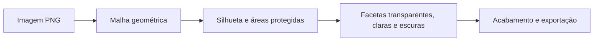

<div align="center">

# Image Geometric Mask

<div align="center">
 <a href="https://ograda.solutions"></a>&nbsp;&nbsp;<a href="https://ograda.solutions"></a>
  <p>
    
    
  </p>
</div>

**Image Geometric Mask** é um filtro geométrico procedural que transforma ilustrações em composições facetadas. Uma malha configurável cria silhuetas recortadas, espaços transparentes e variações de luminosidade **sem redesenhar a arte original**.

O projeto pode processar uma imagem, todos os arquivos PNG de uma pasta ou gerar prévias sobre fundo branco. Cada execução pode produzir várias combinações reproduzíveis por **seed**.


## Como funciona



A **geometria** define as peças; a **silhueta** determina o contorno externo; as **áreas protegidas** impedem vazios sobre partes importantes; e a **seed** altera a distribuição dos efeitos sem mudar a malha.

## Instalação

Requer **Python 3.10 ou superior**. No PowerShell, na pasta do projeto:
<div align="left">

```powershell
py -m pip install -r instal.requirements
```
</div>

## Uso rápido
<div align="left">

```powershell
# Processar todos os arquivos PNG da pasta configurada
py .\crystal_filter.py

# Processar somente uma imagem (com ou sem a extensão .png)
py .\crystal_filter.py --single "arquivo.png"

# Visualizar as formas sobre fundo branco
py .\crystal_filter.py --preview

# Gerar JSONs de diagnóstico junto aos resultados
py .\crystal_filter.py --debug
```
</div>

### Comandos e parâmetros

| Argumento | Função |
| --- | --- |
| `--batch` | Processa explicitamente os PNGs da pasta de entrada. |
| `--single "imagem"` | Processa um PNG por nome, com extensão ou caminho completo. |
| `--preview` | Gera testes brancos, diagrama da malha e mapa das áreas protegidas. |
| `--debug` | Salva JSONs com seed e estados das facetas; pode ser combinado com `--preview`, `--single` ou `--batch`. |
| `--config "config.json"` | Usa outro arquivo de configuração. |
| `--input-dir "images"` | Sobrescreve a pasta de entrada do processamento em lote. |
| `--count 12` | Gera 12 variações por imagem, sobrescrevendo `output.count`. |
| `--seed 100` | Define a seed inicial para reproduzir as variações. |
| `--template hexagon` | Seleciona uma geometria sem editar o JSON. |
| `--cell-width 135` | Ajusta a largura da célula ativa. |
| `--cell-height 197` | Ajusta a altura da célula ativa. |
| `--unit px` | Define a unidade: `px` ou `relative`. |
| `--help` | Exibe a ajuda completa no terminal. |

Exemplos de combinações:

<div align="left">

```powershell
py .\crystal_filter.py --single "imagem" --count 10 --seed 100
py .\crystal_filter.py --preview --template rhombus --cell-width 135 --cell-height 197
py .\crystal_filter.py --preview --debug
py .\crystal_filter.py --batch --input-dir ".\images"
```
</div>

> `--preview` testa a geometria em branco. `--debug` **não** ativa a prévia: ele adiciona os arquivos JSON de diagnóstico ao modo escolhido.

## Geometrias e dimensões


A geometria ativa é escolhida em `geometry.template`.<br>As dimensões de cada formato são definidas em `geometry.shapes`.

| Template | Dimensões | Resultado |
| --- | --- | --- |
| `rhombus` | `width`, `height` | Diagonais horizontal e vertical dos losangos. |
| `square` | `side` | Quadrados de lados iguais. |
| `rectangle` | `width`, `height` | Retângulos com largura e altura independentes. |
| `triangle` | `width`, `height` | Triângulos isósceles definidos por base e altura. |
| `hexagon` | `width`, `height` | Hexágonos definidos por suas dimensões totais. |
| `free` | `polygons`, `step_x`, `step_y`, `row_shift` | Polígonos personalizados e regras de repetição. |

<div align="left">

- **`unit: "px"`** usa pixels da resolução de trabalho (`work_size`).
- **`unit: "relative"`** usa proporções da imagem; para quadrados, a dimensão de referência é o menor lado do canvas.
- **Peças menores** produzem mais facetas; **peças maiores** produzem divisões mais amplas.
- No template `free`, os vértices são normalizados dentro da célula de repetição. `width`, `height` e `unit` podem ser definidos no próprio bloco; quando omitidos, a escala é herdada de `rhombus`.

Para um hexágono **regular**, orientado com vértices superior e inferior, a relação entre as dimensões totais é `height = 2 × width / √3`. Outras proporções produzem hexágonos simétricos, mas não regulares.
</div>

## Configuração (`config.json`)

| Seção | Responsabilidade |
| --- | --- |
| `output` | Pasta de saída, quantidade de variações, formatos, resolução final e painéis comparativos. |
| `work_size` | Resolução usada durante a aplicação do filtro. |
| `geometry` | Template, dimensões, posição da malha e margem do canvas. |
| `silhouette` | Forma geral da silhueta e recortes periféricos. |
| `protected_areas` | Elipses que protegem regiões importantes contra transparência. |
| `facets` | Quantidade e intensidade de facetas apagadas, escuras e claras; aparência das linhas. |
| `finish` | Granulação, contraste e saturação aplicados à imagem como um todo. |
| `debug_white` | Cores e visibilidade da grade no modo de prévia branca. |
| `batch` | Pasta de entrada, continuidade após erros e número de tentativas adicionais. |

### Silhueta (`silhouette`)
<div align="left">

`shape: "crystal_superellipse"` seleciona as peças por uma região matemática semelhante a um retângulo de cantos arredondados. **A borda renderizada continua seguindo os polígonos**, não uma linha curva.

- `radius.x` / `radius.y`: extensão horizontal e vertical da região.
- `power.x` / `power.y`: formato da superelipse; valores menores deixam a silhueta mais elíptica, e maiores, mais retangular.
- `outer_prune.min` / `outer_prune.max`: intervalo de peças periféricas que o script tenta remover.
- `allow_detached_facets`: quando `true`, permite partes desconectadas da estrutura principal; **não garante** que elas serão criadas.
</div>

### Áreas protegidas (`protected_areas`)

As elipses definem regiões nas quais não devem surgir buracos. Cada entrada segue o formato:
<div align="left">

```json
[0.5, 0.49, 0.24, 0.25]
```
</div>
Os valores representam **centro X, centro Y, raio X e raio Y**, normalizados entre 0 e 1. É possível combinar várias elipses para proteger personagens ou objetos em posições distintas. <br><span style="color:green;">`safety_margin`</span> amplia essa região de proteção.

### Facetas (`facets`)
<div align="left">

- `holes`: quantidade de peças internas totalmente transparentes.
- `dark` / `light`: quantidades de peças escurecidas e iluminadas.
- `dark_strength` / `light_strength`: intensidade máxima desses efeitos.
- `subtle_variation`: pequena variação aleatória de luminosidade nas facetas normais.
- `minimum_hole_separation_cells`: afastamento mínimo entre peças transparentes; `0` permite vazios adjacentes.
- `geometry.lines`: cor (`color`), opacidade (`opacity`) e espessura (`width`) das divisões, compartilhadas com a prévia branca.
</div>

### Acabamento (`finish`)

`grain` adiciona granulação fina aos pixels; `contrast` e `saturation` ajustam a imagem inteira, independentemente do estado de cada faceta. Valores de `1.0` preservam o contraste e a saturação originais.

### Prévia branca (`debug_white`)

Usada somente com `--preview` para facilitar a leitura da malha. `normal_color`, `dark_color` e `light_color` definem as cores das facetas; `draw_grid` mostra ou oculta as divisões. A aparência das linhas vem de `facets.geometry.lines`.

### Processamento em lote (`batch`)
<div align="left">

- `input_directory`: pasta onde o script procura arquivos `.png` (sem percorrer subpastas).
- `retry_on_error`: número de **novas tentativas**, além da tentativa inicial. Com `3`, há até quatro tentativas no total.
- `continue_on_error`: define se o lote continua com a imagem seguinte quando todas as tentativas falham.
</div>
As tentativas de uma mesma imagem reutilizam as seeds. Uma saída incompleta não é publicada como resultado final.

## Arquivos gerados

Os resultados são organizados em pastas com o nome de cada imagem original:
<div align="left">

```text
results/
├── _preview/                 # testes brancos do --preview
└── final-fantasy-i/
    ├── rhombus-final-fantasy-i-seed-00000000000000000100.png
    ├── rhombus-final-fantasy-i-seed-00000000000000000100.webp
    └── rhombus-final-fantasy-i-comparativo.png
```
</div>
Os nomes e as seeds acima são ilustrativos; <br>Com <span style="color:green;">`contact_sheet: true`</span>, o script agrupa miniaturas em painéis comparativos; <br><span style="color:green;">`contact_sheet_page_size`</span> limita a quantidade por painel. <br>**Arquivos JSON individuais só são gerados com <span style="color:green;">`--debug`</span>.**
<br><br>
A exportação pode incluir PNG e WebP com transparência. <br>O JPEG, quando ativado, utiliza fundo branco porque não possui canal alfa. <br><br>**As imagens originais não são sobrescritas.**

</div>